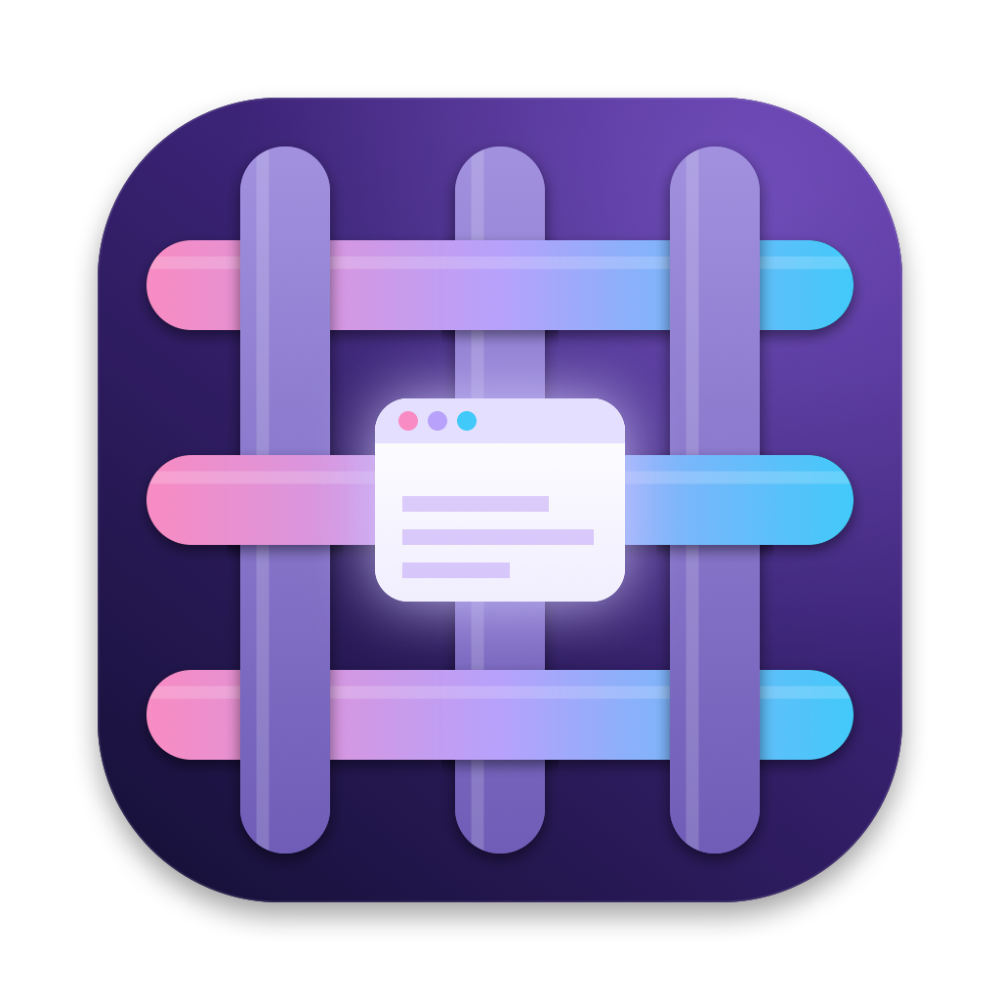
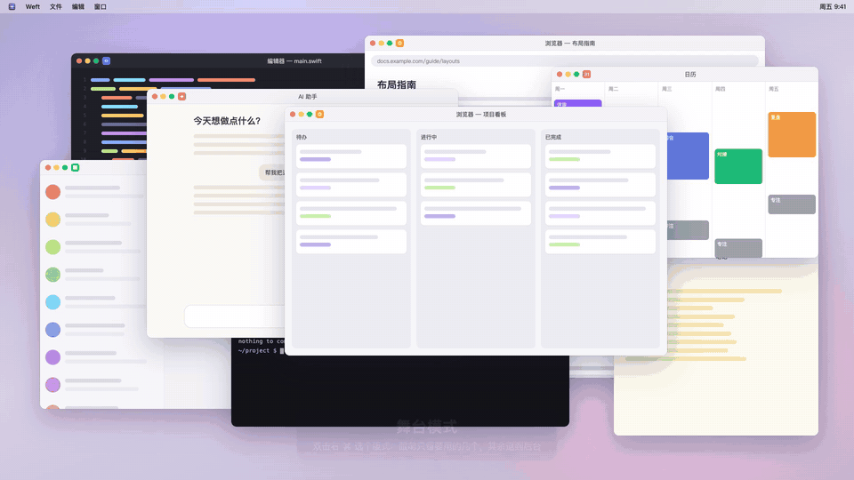

<p align="center">
  
</p>

<h1 align="center">Weft</h1>

<p align="center">
  <b>However many windows you open, keep only the ones you need right now in front of you.</b><br>
  A scene-centric window workbench for macOS: per-display scenes, grid layouts, pinyin window search, and AI-assisted organizing.
</p>

<p align="center">
  <a href="README.md">中文</a> · English
</p>

<p align="center">
  
</p>

---

**Weft** is the thread that shuttles between the warp threads and weaves loose strands into cloth. Weft weaves a messy screen of windows into an orderly workspace.

> The UI is currently in Simplified Chinese. English localization is on the [roadmap](ROADMAP.md).

## Features

- 🎭 **Stage mode**: each display gets a layout and a few slots; every other window steps backstage (moved off-screen, not minimized, so switching is instant). Double-tap right ⌘ to pick a layout, fill empty slots from thumbnails, drag a window to another slot to swap, drag the divider to resize.
- 🎬 **Scenes**: a set of windows you look at together on one display. Switch with ⌃← / ⌃→ or a four-finger swipe, like macOS Spaces but faster, and windows never get lost on another Space.
- 🔗 **Cross-display binding**: bind "Messages" on the laptop to "Coding" on the external display; switching to either switches both.
- 🪶 **Floating apps**: Finder, Preview, System Settings and the like stay out of scenes and float on top.
- ✨ **AI organize** (optional): describe how you work ("Claude sometimes alone, sometimes with WeChat; split my browser windows") and the AI proposes scenes that fit window sizes and your screens. Works with DeepSeek, Qwen, Kimi, GLM, Doubao, OpenAI, OpenRouter, Ollama, or any OpenAI-compatible endpoint.
- 🔎 **Window search** with pinyin and fuzzy matching, by window rather than by app.
- 🔢 **Number slots**: ⌥⇧3 pins the current window to 3; ⌥3 jumps there, press again to jump back.
- 🖥️ **Display-aware**: external displays are recognized by position, so scenes follow you between office and home monitors and restore when you plug back in.

## Install

Requires macOS 14 (Sonoma) or later. Universal binary (Apple silicon + Intel).

```bash
# Homebrew
brew install --cask ahuili/tap/weft

# or the one-line installer
curl -fsSL https://raw.githubusercontent.com/ahuili/weft/main/scripts/install.sh | bash
```

Or download the DMG from [Releases](https://github.com/ahuili/weft/releases/latest). Weft is not notarized yet; if macOS refuses to open it, right-click the app → Open, or run `xattr -dr com.apple.quarantine /Applications/Weft.app`.

Build from source (Command Line Tools are enough):

```bash
git clone https://github.com/ahuili/weft.git && cd weft && ./scripts/build-app.sh --install
```

Weft needs **Accessibility** (required) and **Screen Recording** (thumbnails only) permissions.

## Privacy

Everything stays on your Mac (`~/Library/Application Support/Weft/`). AI features, if you configure them, send only app names and window titles to the model you choose (chat apps send app names only). No telemetry.

## License

[MIT](LICENSE)
