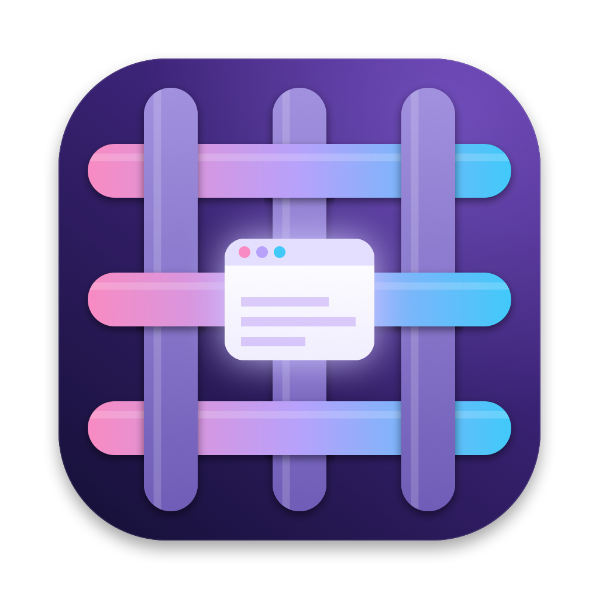
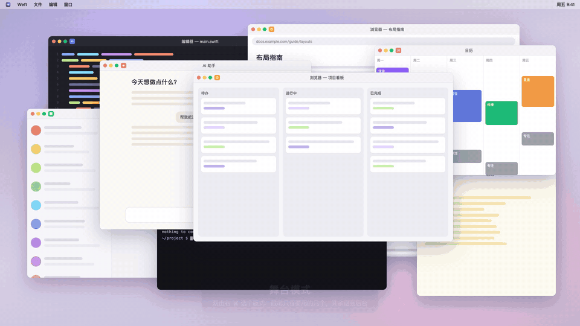

<p align="center">
  
</p>

<h1 align="center">Weft</h1>

<p align="center">
  <b>窗口开得再多，眼前也只留你现在要用的那几个。</b><br>
  一个以「场景」为中心的 macOS 窗口工作台：每块屏各自切场景、格子版式、拼音找窗口、AI 帮你整理。
</p>

<p align="center">
  <a href="https://github.com/ahuili/weft/releases/latest"></a>
  
  
  <a href="LICENSE"></a>
</p>

<p align="center">
  中文 · <a href="README.en.md">English</a>
</p>

<p align="center">
  
  <br><sub>完整介绍视频（约 1 分钟）：<a href="https://github.com/ahuili/weft/releases/latest">Releases 页面</a></sub>
</p>

---

**Weft（纬线）**：织布时在经线之间来回穿梭、把散线织成一块布的那根线。Weft 做的就是这件事——把满屏散乱的窗口织成有秩序的工作面。

## 它解决什么

窗口乱，不是因为开得多，而是因为**所有窗口都在同时争夺你的注意力**。macOS 自带的桌面（Spaces）切起来慢、窗口散在看不见的桌面上、一个窗口只能在一个桌面里。Weft 换了一种做法：

| | 系统桌面 | Weft 场景 |
| --- | --- | --- |
| 一个窗口能在几处 | 只能一个桌面 | 可以出现在多个场景里（微信既在「回消息」也在「写周报」） |
| 多块屏 | 一起切，或者各切各的但不能组合 | 每块屏各自切；想一起切就**绑定** |
| 窗口怎么摆 | 自己拖 | 每个场景自带版式（左右 / 一主两辅 / 三栏 / 四宫格），切过去就摆好 |
| 访达、预览这类随开随关的 | 跟着桌面走 | 设成**随手窗口**，浮在上面，切场景不藏 |
| 建桌面 | 一个个手动建 | 一句话让 AI 按你的习惯建一批 |

## 功能

- 🎭 **舞台模式**：每块屏 = 一个版式 + 几个格子，其余窗口退到后台（不最小化，进出都是瞬间）。双击右 ⌘ 弹出版式盘，空格子里直接挑窗口；拖进别的格子就换位，拉中间的边就改比例。
- 🎬 **场景**：一块屏上一组要一起看的窗口。⌃← / ⌃→ 或四指左右滑，像切系统桌面一样切，但更快、窗口不会丢在别的桌面上。
- 🔗 **跨屏绑定**：把笔记本的「回消息」和大屏的「写代码」绑在一起，切任意一个，另一块屏跟着换。随时绑、解绑、换绑。
- 🪶 **随手窗口**：访达、预览、系统设置这类 App 不进场景、不占格子，开了就浮在上面。
- ✨ **AI 整理**：写一句「Claude 有时单独、有时配微信；浏览器几个窗口分开放」，AI 结合窗口大小、屏幕放不放得下、你的使用习惯，建一批场景。支持 DeepSeek、通义千问、Kimi、智谱、豆包、OpenAI、OpenRouter、Ollama 或任意 OpenAI 兼容端点。**AI 是选填的**，不配也能用其余全部功能。
- 🔎 **拼音找窗口**：双击右 ⌥ 打开总控，`wx` → 微信，`gh pr` → 那个 GitHub PR 的 Chrome 窗口。按**窗口**切，不是按 App。
- 🔢 **数字槽位**：⌥⇧3 把当前窗口钉成 3 号，之后 ⌥3 一键直达，再按一次跳回刚才那个。
- 🖥️ **插拔屏不乱**：外接屏按「位置」认（扩展屏1 / 扩展屏2），公司的屏和家里的屏都是扩展屏1，场景跟着走；拔掉后场景可以临时摆在笔记本上，插回来自动归位。
- 🧠 **记住你怎么工作**：本机统计几点用什么窗口、哪些窗口经常来回切，用来排序候选和推荐场景。数据只在本机。

详细用法见 [使用手册](docs/使用手册.md)。

## 安装

需要 macOS 14 (Sonoma) 或更新，Apple 芯片和 Intel 都支持。

### 方式一：Homebrew（推荐）

```bash
brew trust ahuili/tap    # 新版 Homebrew 要先信任第三方 tap（只需一次；旧版没有这个命令，跳过即可）
brew install --cask ahuili/tap/weft
```

以后升级：`brew upgrade --cask weft`

### 方式二：一行脚本

```bash
curl -fsSL https://raw.githubusercontent.com/ahuili/weft/main/scripts/install.sh | bash
```

下载最新发布版装到「应用程序」，并直接打开。

### 方式三：手动下载

到 [Releases](https://github.com/ahuili/weft/releases/latest) 下载 `Weft-x.y.z.dmg`，把 Weft 拖进「应用程序」。

> Weft 还没有 Apple 公证，第一次打开时 macOS 可能提示「无法验证开发者」。任选一种解决：
> - 在「应用程序」里**右键 Weft → 打开**，再点「打开」；或到 系统设置 › 隐私与安全性 底部点「仍要打开」。
> - 或者在终端运行：`xattr -dr com.apple.quarantine /Applications/Weft.app`
>
> 用 Homebrew 或一行脚本安装的不会遇到这个问题。

### 方式四：从源码构建

```bash
git clone https://github.com/ahuili/weft.git && cd weft
./scripts/build-app.sh --install        # 编译并装到 ~/Applications，然后打开
```

只需要 Xcode Command Line Tools（`xcode-select --install`），不需要完整的 Xcode。

## 第一次打开

1. 菜单栏出现 Weft 图标，同时弹出引导。
2. **授权**：
   - **辅助功能**（必需）：用来读窗口、摆窗口。
   - **录屏与系统录音**（建议）：只用来画窗口缩略图，不录制、不上传。
3. **选快捷键**：页面上可以实时试按。默认：双击右 ⌘ = 舞台，双击右 ⌥ = 总控，鼠标碰屏幕左边缘 = 侧栏。
4. **选 AI 模型**（可跳过）。
5. 打开「场景工作台」，把窗口拖进格子建第一个场景——或者让 AI 帮你建一批。

## 隐私

- 所有窗口数据、使用统计、场景都只存在本机：`~/Library/Application Support/Weft/`。
- 只有你配置了 AI 并主动使用 AI 功能时，才会把**App 名和窗口标题**发给你选的模型；微信、QQ、飞书等聊天软件只发 App 名。不发截图。
- API Key 存在系统钥匙串里。
- 没有统计上报，不联网检查更新（版本更新请用 Homebrew 或 Releases）。

## 路线图

接下来要做的事见 [ROADMAP.md](ROADMAP.md)，每个版本改了什么见 [CHANGELOG.md](CHANGELOG.md)。

## 参与

欢迎提 Issue 和 PR。

```bash
swift build && .build/debug/WeftSelfTest     # 离线测试（舞台格子、多屏、场景、绑定、AI 输出校验…）
```

- 代码结构：`Sources/WeftCore`（窗口、舞台、场景模型，不依赖界面）、`Sources/WeftAI`（模型调用和提示词）、`Sources/Weft`（AppKit + SwiftUI 界面）、`Sources/WeftSelfTest`（离线测试）。
- 设计思路和每一轮的取舍记在 [docs/产品规划.md](docs/产品规划.md)。
- 运行中的 Weft 可以用 `Weft ctl <命令>` 驱动（调试用），见 [使用手册](docs/使用手册.md#开发)。

## 许可证

[MIT](LICENSE)
