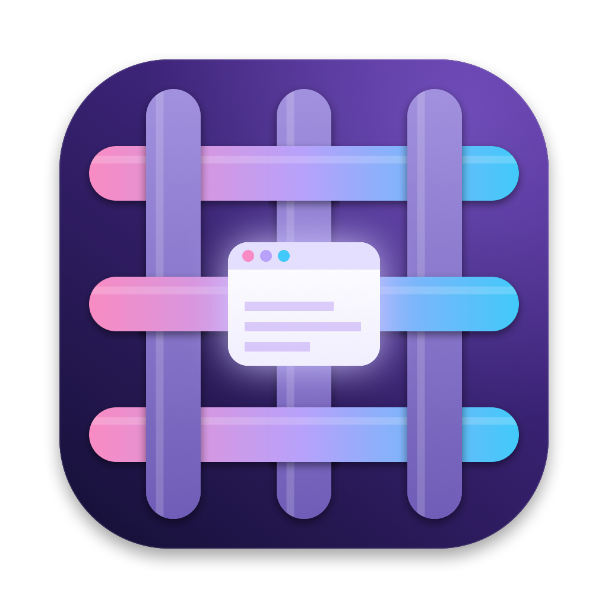

# Weft 使用手册（v0.6.8）

**Weft（纬线）**：织布时在经线间来回穿梭的那根线，把散乱的线织成一块布。Weft 做的就是这件事——把满屏散乱的窗口织成有秩序的工作面。图标就是这个意象：经纬交织，正中一扇发光的窗口（你正在用的那个）。

安装见 [README](../README.md#安装)；设计思路见 [产品规划](产品规划.md)。

## 一句话

窗口开得再多，眼前也只留你现在要用的那几个。

## 入口（触发方式都能在设置里改）

| 入口 | 默认 | 做什么 |
| --- | --- | --- |
| **舞台模式** | 双击 右 ⌘ | 弹出版式盘选 1~4 格的版式，空格子里直接挑窗口，其余退到后台。再按一次退出 |
| **总控** | 双击 右 ⌥ | 全屏面板：拼音搜索、场景、习惯推荐、整理桌面、排布建议 |
| **快速切换** | 按住 ⌥ 连按 Tab | 按**窗口**切（不是按 App），顺序是你的真实使用顺序；松开就切过去。舞台模式下 = 换上台 |
| **数字槽位** | ⌥1~9 / ⌥⇧1~9 | 把常用窗口钉到数字上，一个键直达；已经在它上面时再按一次就跳回刚才那个。详见下文 |
| **侧栏** | 鼠标碰左边缘 / 双击 左 ⌥ | 所有窗口的指挥台：打开后**按数字直达**，鼠标停在窗口上按 ⇧数字 编号；打字搜（结果也带数字）；「此刻」提示你这个时间常用的场景 |

第一次启动会弹出引导：授权 → 选快捷键（页面上能实时测试）→ 选 AI 模型（可跳过）→ 舞台与侧栏设置。之后在菜单栏图标 → 设置里改。

## 舞台模式

模型只有一条：**每块屏幕 = 一个版式 + 几个格子，每个格子放一个窗口或空着**。位置固定、不猜测、不自动降级。

- **版式盘**：按舞台快捷键，屏幕中间浮出 6 种版式——专注 · 铺满 · 左右 · 一主两辅 · 三栏 · 四宫格，数字键 1~6 直接选（R 换比例、M 左右翻转）。预览里能看到现在台上的窗口会落在哪。版式盘开着时再按一次快捷键 = 退出舞台。
- **空格子弹候选**：换成更多格子的版式后，空格子里直接浮出候选窗口的缩略图（经常和主窗口一起用的排前面），点一下或按数字就填进去，打字能搜（拼音也行），Tab 跳到下一个格子，Esc 让它空着。空着的格子有个「＋」占位，点它随时再选。
- **转轮**：鼠标停在某个格子里窗口的**标题栏**上（空格子整格都行；窗口里面的 ⌥+滚动还归 App，比如 VS Code 的快速滚动），**按住 ⌥ 滚动滚轮**（或触控板），这个格子里的窗口原地轮换候选（触控板每滑一段换一个，手指离开后的惯性不算），也可以直接点小框里的图标，松开 ⌥ 就定下来。换副屏资料、换聊天窗口，一个手势搞定。
- **切到哪个换进哪格**：⌘Tab、点 Dock、点通知切来的窗口，有空格子先填空格子，否则换进你正在用的那个格子。
- **锁格**：台上胶囊或候选面板里点 🔒，锁住的格子不会被切来的窗口换掉（比如左边一直放编辑器）。
- **磁吸**：台上的窗口被你挪歪了、或者 App 自己跑偏了，松开鼠标就吸回格子。松手时落在哪决定发生什么：
  - **同一块屏里拖进别的格子 = 换位**；
  - **从别的屏拖过来（台上的窗口、浮着的窗口都行）= 插进去**：拖动时那块屏上会出现紫色虚线框，告诉你松手后它落在哪；有空格就放空格，没有就版式长一格（专注 → 左右 → 一主两辅，宽屏是三栏 → 四宫格），落在某个窗口的左半边 / 上半边就插在它前面；四宫格满了就换掉落点那一格。随手 App 不参与；
  - 拖到还没舞台的屏 = 在那块屏上台；
  - **拉两个窗口中间的那条边 = 改比例**，旁边的窗口跟着让（左右、一主两辅、三栏、四宫格都行）；
  - **双击标题栏 / 绿色按钮全屏 / 系统「填充」= 临时铺满**，Weft 不跟你抢，缩回来以后再归位。
- **跟 macOS 自己的操作合拍**：最小化或 ⌘H 一个台上窗口 = 请它下台；关掉一个窗口，刚才在这个格子里的那个窗口回来（像关掉标签页回到上一个），没有就留空格子。
- **乱了也不怕**：版式盘里按 **空格 = 归位**（每个窗口回自己的格子、跑出来的后台窗口藏回去），**Z = 撤销上一步**（换了谁、换了版式、拖了位置、改了比例都能撤）；侧栏舞台面板上也有「↶」和「归位」。
- 多屏各自独立：每块屏有自己的版式和格子；**版式盘弹在鼠标所在的那块屏**，选的版式就作用于那块屏。每个窗口记得自己的「家」，从后台叫回来回到自己的屏幕。
- **叠放**：一个格子里可以叠最多 5 个窗口。越下面的越靠左上，往上每层向右下错开一点，下面的窗口露出标题栏和左边一条。
  - 叠上去：拖窗口时**按住 ⇧** 松手（落点框写着「叠上去 · 第 N 层」，同一块屏也行）；或者在侧栏 / 总控里右键窗口 →「🗂 叠到…」。
  - 换到上面：点露出来的那条边，它就翻到最上面；或者鼠标停在这一摞顶上（露出的边、最上面窗口的标题栏）**按住 ⌥ 滚动**，这一摞窗口立体展开，滚到哪个、松开 ⌥ 它就翻上来。
  - 关掉最上面那个，下面那层顶上来；把压在下面的拖到别的格子 = 叠到那一格上。换位、换版式、跨屏拖动时整摞跟着走；这一格换成别的窗口时整摞退到后台。
  - 场景会记住叠放，下次摆出来照原样叠好。格子太小（宽不到 640 或高不到 420）不让叠。
- 有最小宽度的 App（企业微信 1060、App Store 1000、Claude 600…）会多分它一点宽度；实在放不下（几个都不肯变窄），就**允许互相盖住一部分**：左边的贴左、右边的贴右，点到哪个它就浮到上面。候选里标「可能太宽」，转轮会跳过它们。改不了尺寸的窗口（系统报告的）不参与舞台、原样悬浮；上过台的窗口哪怕被摆窄了也照常参与，不会变成甩不掉的浮窗。
- App 自己把藏起来的窗口拉回屏幕（App Store 这类）：再藏一次，连续藏不住就改用最小化。
- 退出舞台：后台窗口回到进入前的位置。插拔屏、Weft 退出（包括被 kill）时自动放回；锁屏期间不做任何「窗口没了」的判断，当时放不回去的（在别的桌面上）之后能操作了再放回。

## 场景：代替系统桌面

**一个场景 = 一块屏上的一个版式 + 几个窗口**。场景不绑屏幕：摆到哪块屏都行，每块屏各自切换，自由组合（笔记本放「回消息」、大屏放「写代码」）。切场景是原地把窗口换掉，比左右滑系统桌面快，也不会有窗口散在看不见的桌面上。

- **场景工作台**（菜单栏「场景工作台…」，切换器里点「编辑场景」或按 E；一个场景都没有时启动就打开）：左边是你的场景，中间是选中场景的样子，右边是所有窗口——**把窗口拖进格子**就建好了，点一格也能从列表挑；上面换版式、比例、改名字和图标。场景正摆在某块屏上时，这里改了屏幕立刻跟着变。还可以「AI 帮我建一批」。
- **场景是活的**：一块屏正摆着某个场景时，你在屏上做的调整（换窗口、换版式、拉比例、拖动换位）自动存进这个场景，不用另外保存。
- **点 Dock / ⌘Tab 切到别的窗口**：不再悄悄换掉你右边的窗口。
  - 这个窗口在某个场景里 → 直接切到那个场景；
  - 不在任何场景里 → 它单独开一个新场景（马上能用），屏幕顶部浮出一张卡片：刚才那个场景的缩略图，**鼠标停在哪一块，屏幕上那块就亮起紫框**，点下去就回到刚才的场景、那一块换成它；也可以「多加一格」。不理它，8 秒后自己收起，保持单独。
- **场景切换器**（默认双击左 ⌃，你的设置里是双击右 ⌥，可在设置里改）：鼠标所在的屏上浮出一排场景卡片，卡片就是场景摆好后的样子（真实窗口截图拼出来）。两指左右滑 / ← → / 滚轮 选，↩ 或点一下摆到这块屏；数字键直达；**再按一次快捷键 = 下一个**。Tab 换目标屏。
- **场景归屏**：每个场景属于一块屏——笔记本、扩展屏1、扩展屏2（外接屏按从左到右排号，认的是位置不是哪台显示器：白天公司的屏、晚上家里的屏都是扩展屏1，场景跟着走）。在哪块屏切就只列那块屏的场景，不会把别的屏的窗口切过来（共享屏幕时也不会露出不该露的）。想换屏：切换器里按 M 或点「换到另一块屏」，场景工作台里改「属于」。拔掉扩展屏后，它的场景出现在笔记本的切换器里（标「扩展屏1 的 · 没接」）可以临时摆；插回来（或换了一台显示器）时自动摆回扩展屏1，笔记本回到它自己上次的场景。
- **绑定（跨屏一起切）**：场景只管一块屏，但可以把不同屏的场景绑在一起——场景工作台里「切到它时 扩展屏1 跟着切到 [不跟 ▾]」，选一个就绑上，选「不跟」解绑，换一个就换绑。绑好后在任何一块屏上切到其中一个（⌃←→、四指滑、切换器），另一块屏同时换。老的「组合」可以在工作台里打开「联动」。点 Dock 自动切过去的不联动。
- **附属窗口**：台上的 App 自己弹出来的窗口（微信看图、预览、设置面板、同一个 App 新开的窗口）自动浮着：不进格子、不问、不单独开场景；App 下台时跟着退到后台。想放进格子就在侧栏 / 总控里右键它「放进舞台」。
- **随手窗口**：访达、预览这类随开随关的 App 可以设成「随手」（总控 / 侧栏里右键窗口）：不进场景、不占格子、切场景不藏、不弹「放进哪一块」，原样浮在上面。场景里的窗口关掉后也会自动去掉，不留空格。
- **AI 整理可以提要求**：「AI 帮我建一批」上方的输入框写你的意思（如「Claude 有时单独、有时配微信；浏览器分开放；访达随时开」）。AI 会照着来，同时看窗口现在多大、最窄能压到多少、笔记本放不放得下；同一个窗口可以做成几个变体场景；会建议哪些 App 设成随手窗口。建议能逐个去掉，保存时和已有场景合并（同名覆盖），跨屏的建议自动绑在一起。
- **像切系统桌面一样切场景**（舞台模式下）：**⌃← / ⌃→** 第一下只浮出同样的截图卡片（停在这块屏现在的场景上），按住 ⌃ 再按方向键才挪，⌃Tab 换屏，松开 ⌃ 就摆出来（Esc 不换；一下都没挪就松开，卡片留着、接着用键盘选）；**四指左右滑**卡片跟着手指走，抬手就摆。键盘和触控板都换**鼠标所在的屏**。没开舞台时这两个手势还是系统的。系统的四指滑会同时轻弹一下，可以在 系统设置 › 触控板 › 更多手势 里改成三指或关掉。设置里可关。
- **组合**：几块屏一起摆（每个场景回到上次那块屏）。整理桌面时 AI 给出的跨屏场景会拆成每屏一个场景 + 一个组合；在切换器里按 C 把几块屏现在的样子存成组合。
- **编辑**：在切换器里 E 改名（开头放个 emoji 就换图标）；**U = 用这块屏现在的样子更新这个场景**——先摆出来，用版式盘、候选、拖动、拉边调好，再按 U；N 存成新场景；⌫ 两下删除。
- **插拔屏**：舞台不退出。拔掉外接屏，它上面的窗口被系统挪到笔记本后退到后台，所有场景都能在笔记本上摆；插回来时，外接屏原来的场景自动摆回去。
- **系统桌面**：Weft 够不着别的系统桌面上的窗口（macOS 不让别的 App 跨桌面摆窗口），场景里这样的窗口会标「别处」，切换器顶部提示「合并桌面…」。舞台开着时你滑到别的系统桌面，Weft 在那块屏上暂停（不藏窗口、不抢着上台），滑回来恢复。

## 搜 App

总控和侧栏的搜索除了窗口，也搜**现在没有窗口的 App**（退出了的、开着但没窗口的），排在窗口结果下面，点一下或回车（没有匹配的窗口时）就打开。支持拼音（`jsq` → 计算器）和英文名。

## 数字槽位：最快的切换

不用找，按数字。

- **钉住**：切到某个窗口，按 ⌥⇧3，它就是 3 号。在总控里选中一个窗口再按 ⌥⇧数字也行，或者在窗口上右键 →「钉到数字」。
- **直达**：⌥3 一下到 3 号；舞台模式下就是「让 3 号上台」（回到它自己的屏幕）。
- **来回**：已经在 3 号上时再按 ⌥3，跳回刚才那个窗口。两个窗口之间来回只要一个键。
- **重启也有效**：同时记住 App 和标题。窗口关了重开、重启电脑后窗口编号变了，都能认回来；App 没开就打开它，所以「⌥4 = 微信」永远有效。
- 总控顶部和侧栏里有 1~9 的槽位条，一眼看到每个号码是谁；窗口卡片和 ⌥Tab 里也会标出「⌥3」。
- 修饰键可在设置 → 快捷键里换成 ⌃ 或 ⌃⌥（⌥+数字会占掉 ¡™£¢∞§¶•ª 这几个符号的输入），也可以关掉。

## 整理桌面（总控 ⌘K / 菜单栏「整理窗口…」）

一个面板里把桌面理干净：

1. **桌面地图**：每块屏的所有「调度中心桌面」和上面的窗口一目了然，空桌面是虚线框。
   - **删掉空桌面**：一键删（Weft 驱动调度中心里每个桌面的「移除」按钮，和你手动点 × 一样）。
   - **合并成每屏 1 个**：其他桌面都删掉，上面的窗口由系统挪到当前桌面，不关任何窗口。之后用 Weft 的场景切换，不用再翻桌面。
2. **场景**（配了 AI 后可用）：AI 看所有桌面上的窗口、你的使用时长和来回切换习惯，整理成 3~6 个场景——每个场景是一小组要同时看的窗口，带每块屏的版式（如「回消息：笔记本左右放微信 + 企业微信」）。可以先「试摆」看看，满意再保存；保存后在总控里点「摆出来」一键上台。
3. **清理**：规则即时找出空窗口、重复窗口、好几天没碰的窗口、开着却没窗口的 App；配了 AI 再判断「这件事是不是已经办完了」。勾选后才执行；终端 / 编辑器的同名窗口不算重复，有改动的未命名文档不算空，聊天软件永远不默认退出。

## 记忆：Weft 记得你怎么工作

设置 → 记忆。

- **本机统计**（不经过 AI）：几点用哪些窗口；舞台上同一组窗口稳定摆满 3 分钟就记一笔「几点、哪几个、怎么摆」。
- **记忆笔记**：配了 AI 后每天复盘一次，把统计写成几句话（「早上 9~11 点主要在钉钉和邮件」）。你可以改、删、自己写（「微信永远放笔记本右边」），你写的不会被 AI 覆盖。整理桌面、排布建议、清理都会先读这些笔记。
- **用起来**：
  - **推荐编号**：空着的数字显示你最常用、还没编号的窗口（淡色），点一下（或在侧栏按那个数字）就钉上。全局按空号码会先提示推荐，3 秒内再按一次就钉上。
  - **此刻**：侧栏顶部提示「这个时间（9 点左右）你通常在用 · 回消息 · 摆出来」；同一种摆法出现 3 次还没存，就问你「存成场景？」。点 × 一周内不再提。
- 发给 AI 复盘的只有 App 名、标题和时长；聊天软件只发 App 名。数据在 `memory.json`，可以一键清空。

## AI 管什么（不管什么）

AI **不帮你手动挪窗口**，只做这几件事：

1. **学习习惯**（本机统计，不经过 AI）：哪些窗口经常来回切、几点用什么。用于候选排序、「接下来」推荐、⌥Tab 顺序。
2. **场景**：见上文「整理桌面」。
3. **排布建议**（⌘J）：给出 1~3 套这一刻的摆放方案，画成屏幕缩略图，可以「进入舞台」或「只摆放」（可撤销）。
4. **清理判断**：见上文。

AI 是**选填**的：不配也能用舞台、搜索、⌥Tab、侧栏、桌面整理、习惯推荐和规则清理。

模型由你自己选：Magpie（本机）、DeepSeek、通义千问、Kimi、智谱、豆包、OpenAI、OpenRouter、Ollama，或任意 OpenAI 兼容端点。API Key 存钥匙串。发给模型的只有 App 名和窗口标题；微信、QQ、飞书等聊天软件只发 App 名。

## 性能

窗口列表按 App 缓存，靠辅助功能通知（新建 / 关闭 / 改标题 / 最小化）只重读有变化的 App，位置从窗口服务器直接取：读一次全部窗口从 ~190ms 降到 ~14ms。焦点切换靠通知即时响应，不再等轮询。

## 同一个 App 的多个窗口

比如两个「微信」：通常是主界面 + 单独弹出的聊天 / 公众号 / 图片窗口，点哪个就去哪个。

有的 App 会预先建好一些**隐藏窗口**：钉钉的 `ConvTabListView`、`MainMenuPanelView`（不属于任何桌面），微信那个 280×380 的小窗（在当前桌面上但从不显示）。点了都没反应，v0.4 起会被过滤掉。现在每个窗口都带区分说明（「主窗口 · 左侧」「小窗 · 右上 · 380×520」），侧栏里同一个 App 叠成一组。

## 安装与授权

安装方式（Homebrew、一行脚本、DMG、源码）见 [README](../README.md#安装)。

- 两项权限：**辅助功能**（必需）、**录屏与系统录音**（缩略图，只截图不录制）。发布版签名身份固定，以后更新一般不用重新授权。
- 已经打开开关但还显示未授权：在设置 → 权限里点「重置授权记录」，再重新打开开关；录屏权限打开后点「重启 Weft」。

## 开发

```bash
swift build && .build/debug/WeftSelfTest                 # 离线测试（舞台格子 / 锁格 / 拖动换位 / 多屏 / 锁屏 / 记忆 / 整理规则 / 数字槽位 / AI 输出校验…）
.build/debug/WeftSelfTest --live auto/glm-5.3-flash      # 真实模型（经 Magpie）：指令、AI 场景、AI 排布
WEFT_DEBUG_SHOW=hub|shelf|guide|settings|stage|arrange   # 启动后直接打开某个界面（open --env …）
weft ctl stagekey | layout quad 1 | assign 0 1 <窗口ID> | lock 0 0 | wheel 0 1 2 | picker 0 | pickkey 1 | deskmap <文件> | organize | tryscene 0 | dump <文件> | snap-screen 1 <png>   # 给运行中的 Weft 发调试指令
swift scripts/make-icon.swift build/icon                  # 重新生成图标（再用 iconutil 打成 assets/AppIcon.icns）
```

数据在 `~/Library/Application Support/Weft/`：`settings.json`（快捷键、舞台、侧栏）、`ai.json`（模型，不含 Key）、`habits.json`、`memory.json`、`contexts.json`、`layouts.json`、`stash.json`。

## 已知限制

- 其他桌面（Space）上的窗口不参与舞台；切过去时由系统跳转桌面。
- 后台窗口挪在「自己那块屏」外侧的角落（外面没有别的屏幕的那个角），macOS 会留 1 像素在屏幕边缘。
- 最小化的窗口截不到实时缩略图，会显示缓存画面或 App 图标。
- 从 macOS 15 开始，系统会定期确认 App 是否还需要录屏权限，这是系统行为。
